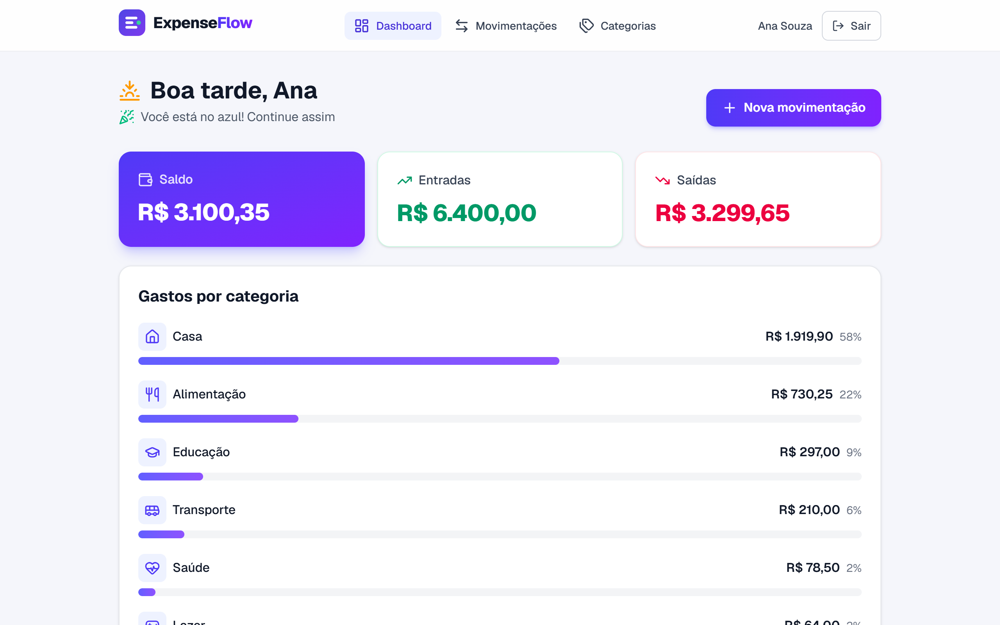
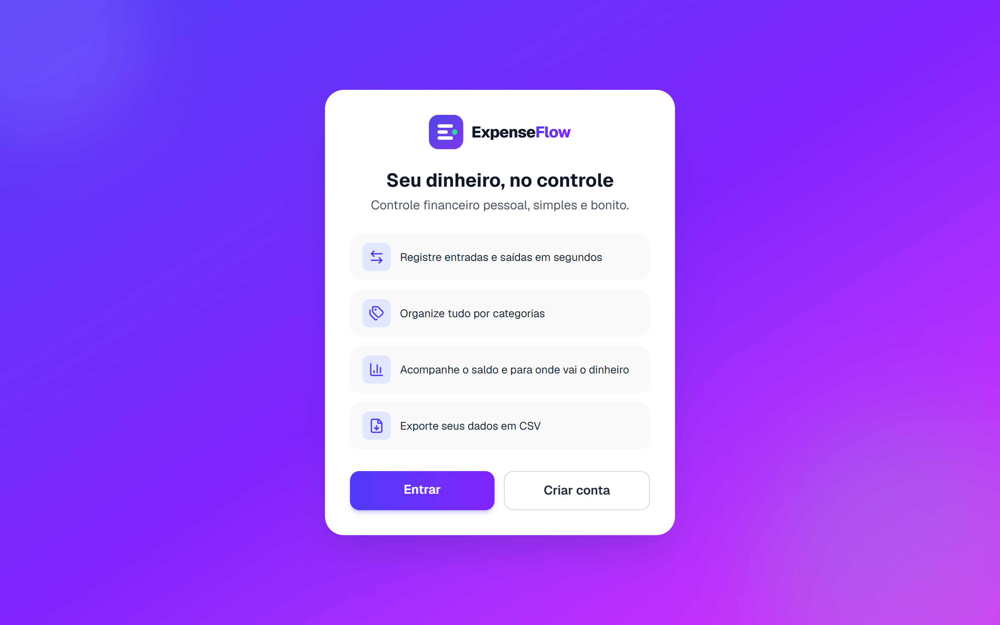
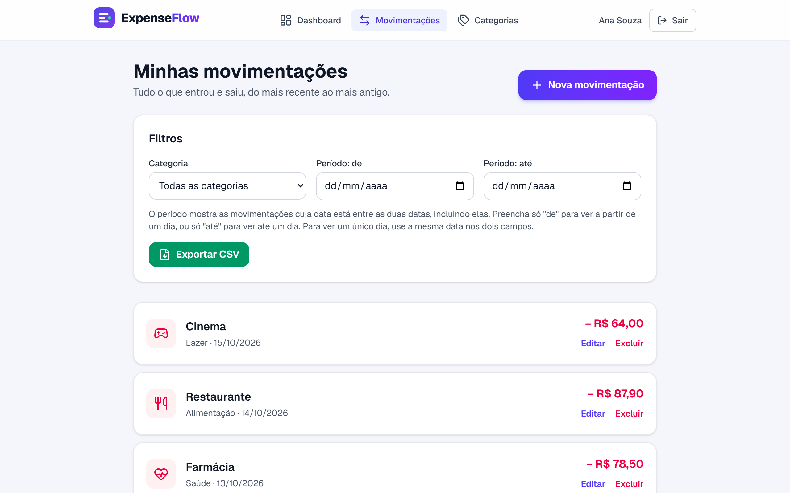
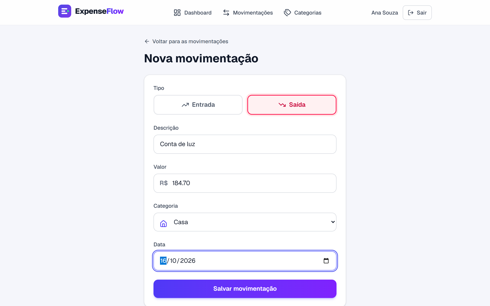
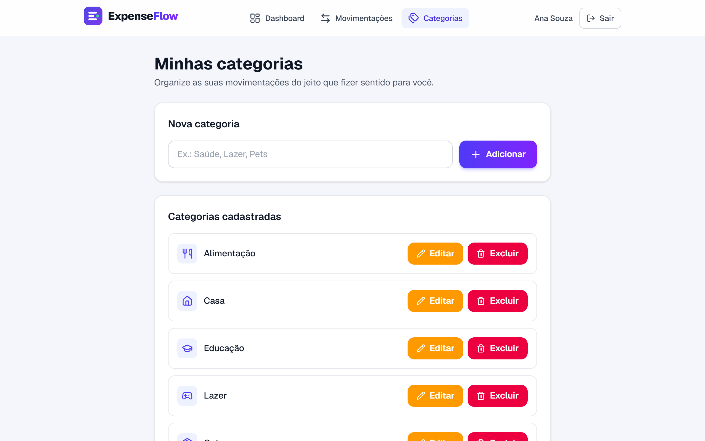
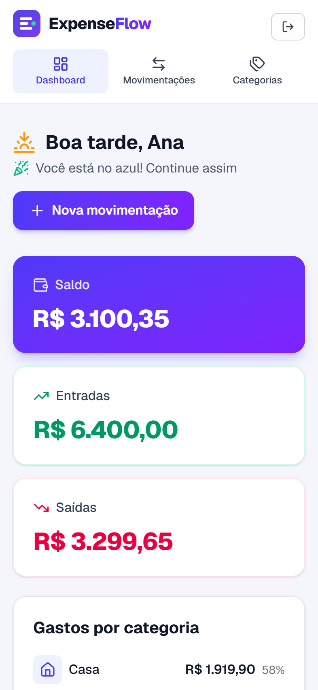
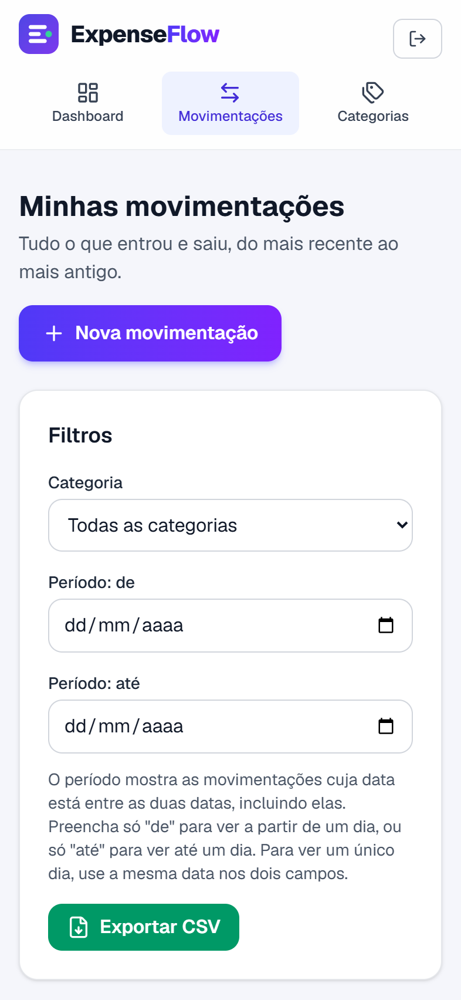

# ExpenseFlow

Aplicação web de **controle financeiro pessoal**: registre entradas e saídas, organize por categorias, acompanhe o saldo e exporte os dados em CSV.

Projeto full stack feito do zero, com foco em regras de negócio bem definidas, segurança dos dados de cada usuário e testes automatizados.

> **Demonstração online:** em breve.

<p align="center">
  
</p>

## Telas

| Início | Movimentações |
|:---:|:---:|
|  |  |

| Nova movimentação | Categorias |
|:---:|:---:|
|  |  |

**No celular**

<p>
  
  &nbsp;&nbsp;
  
</p>

## Funcionalidades

- **Conta de usuário:** cadastro, login e logout, com senha guardada apenas como hash.
- **Movimentações:** cadastrar, listar, editar e excluir entradas e saídas, com filtro por categoria e por período.
- **Categorias:** cinco categorias iniciais para cada novo usuário, e criação, edição e remoção das próprias categorias. Ao remover uma categoria em uso, o usuário escolhe para onde as movimentações vão.
- **Dashboard:** saldo, total de entradas e saídas e gastos por categoria, com porcentagem.
- **Exportação em CSV**, no formato que o Excel em português abre direto, respeitando os filtros aplicados.
- **Interface:** responsiva, com ícones SVG, avisos a cada ação, animações discretas (que respeitam a preferência de "reduzir movimento" do sistema) e textos em português.

## Tecnologias

| Camada | Tecnologias |
|---|---|
| Frontend | Next.js 16, React 19, TypeScript, Tailwind CSS 4, Lucide (ícones) |
| Backend | NestJS 12, TypeScript, Prisma 6, JWT, bcrypt, class-validator |
| Banco de dados | PostgreSQL 16 (via Docker) |
| Testes | Vitest e Supertest, contra um banco de dados real |

## Decisões técnicas

- **Isolamento entre usuários.** Toda consulta usa o usuário do token, e nunca um id enviado pelo cliente. Acessar o dado de outra pessoa responde `404`, e não `403`, para não revelar que ele existe. Testes automatizados cobrem leitura, edição, exclusão, saldo e exportação.
- **Dinheiro sem ponto flutuante.** Os valores são `DECIMAL(10,2)` no banco e o saldo é calculado com `Decimal`, então `0,1 + 0,2` dá exatamente `0,30`. Há um teste para isso.
- **Regras de negócio na API.** Valor sempre positivo, tipo restrito a entrada ou saída (enum no banco), e-mail único e nome de categoria único por usuário. A API recusa campos inesperados.
- **Categoria em uso.** Em vez de bloquear ou apagar em cascata, a remoção exige uma categoria de destino e move as movimentações na mesma transação do banco.
- **Autenticação.** JWT no header `Authorization`, com validade de 7 dias. Login e cadastro têm limite de tentativas por IP, e o CORS aceita só o endereço do frontend.
- **Mensagens de erro em português**, em todos os campos, para quem usa a tela.
- **CSV seguro.** Textos que começam com `=`, `+`, `-` ou `@` recebem um apóstrofo na frente, para a planilha não os executar como fórmula.
- **Testes de integração com banco separado.** Os testes rodam em um banco `<nome>_test`, criado e migrado sozinho, e se recusam a rodar em qualquer outro banco, para nunca tocar nos dados de desenvolvimento.

## Como rodar localmente

Pré-requisitos: **Node.js 20+** (testado com a 24) e **Docker**.

```bash
# 1. Banco de dados (PostgreSQL), na raiz do projeto
docker compose up -d

# 2. Backend, em http://localhost:3001
cd backend
cp .env.example .env        # no Windows (PowerShell): Copy-Item .env.example .env
npm install
npx prisma generate
npx prisma migrate deploy
npm run start:dev

# 3. Frontend, em outro terminal, em http://localhost:3000
cd frontend
cp .env.example .env.local  # no Windows (PowerShell): Copy-Item .env.example .env.local
npm install
npm run dev
```

Abra http://localhost:3000 e crie uma conta.

Antes de usar fora do seu computador, troque o `JWT_SECRET` do `backend/.env` por um valor aleatório:

```bash
node -e "console.log(require('crypto').randomBytes(32).toString('hex'))"
```

### Testes

Com o banco ligado, dentro de `backend`:

```bash
npm run test:e2e
```

São 43 testes de integração, que cobrem autenticação, categorias, movimentações, saldo, filtros, exportação, isolamento entre usuários, limite de tentativas e CORS.

## Estrutura do projeto

```
expenseflow/
├── backend/            API em NestJS
│   ├── prisma/         schema e migrações do banco
│   ├── src/
│   │   ├── auth/           cadastro, login e proteção de rotas
│   │   ├── categories/     categorias
│   │   ├── transactions/   movimentações, saldo e CSV
│   │   └── common/         validação e mensagens em português
│   └── test/           testes de integração
├── frontend/           interface em Next.js
│   ├── app/            telas (login, dashboard, movimentações, categorias)
│   ├── components/     componentes reutilizáveis
│   └── lib/            cliente da API e utilitários
├── docs/               documentação e prints
└── docker-compose.yml  banco de dados para desenvolvimento
```

## Documentação

| Documento | Conteúdo |
|---|---|
| [Requisitos](docs/REQUIREMENTS.md) | Requisitos funcionais e não funcionais, e as decisões tomadas |
| [Regras de negócio](docs/BUSINESS_RULES.md) | As regras que o sistema precisa respeitar |
| [API](docs/API.md) | Todas as rotas, com campos, regras e erros |
| [Banco de dados](docs/DATABASE.md) | Tabelas, relacionamentos e regras |
| [Arquitetura](docs/ARCHITECTURE.md) | Como as partes se conectam |
| [Telas](docs/SCREENS.md) | Telas e identidade visual |
| [Roadmap](docs/ROADMAP.md) | O que foi feito e o que vem a seguir |

## Autoria

Desenvolvido por **Yasmin dos Santos Batista**.

- LinkedIn: [linkedin.com/in/ysminbatista](https://www.linkedin.com/in/ysminbatista)
- GitHub: [github.com/ysminbatista](https://github.com/ysminbatista)

## Próximos passos

- Publicar a aplicação, com link de demonstração e conta de exemplo.
- Integração contínua, para rodar os testes a cada envio ao GitHub.
- Gráficos e relatórios por período, e movimentações recorrentes.
- Recuperação de senha.
